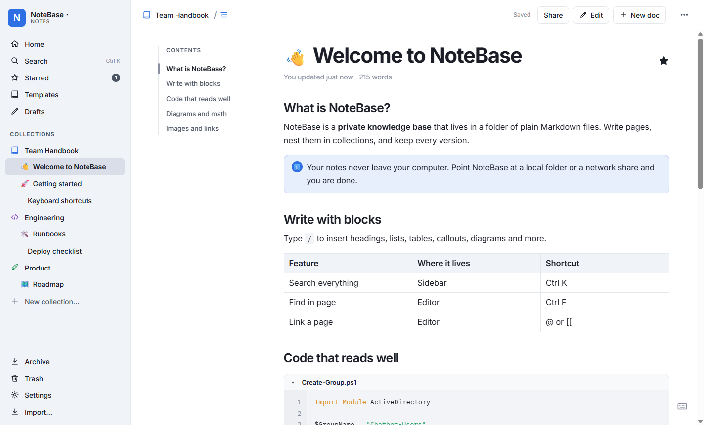
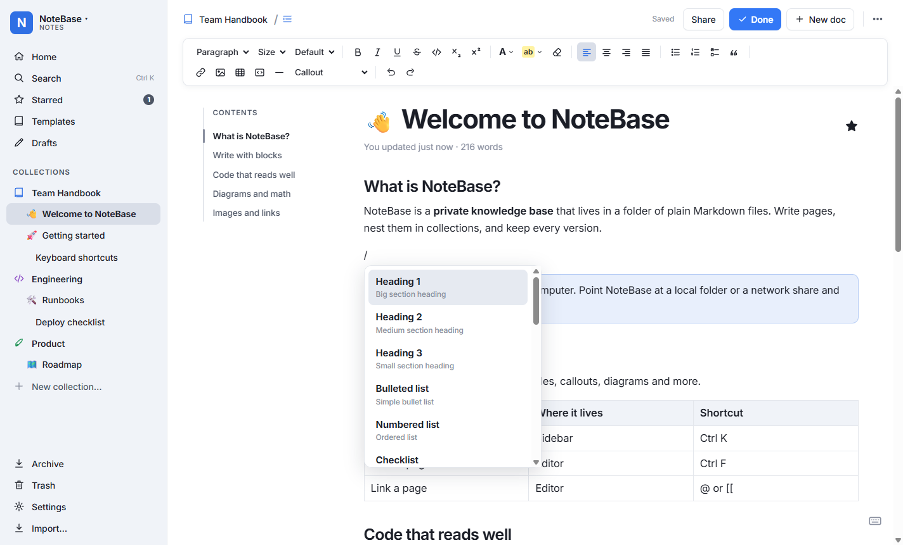
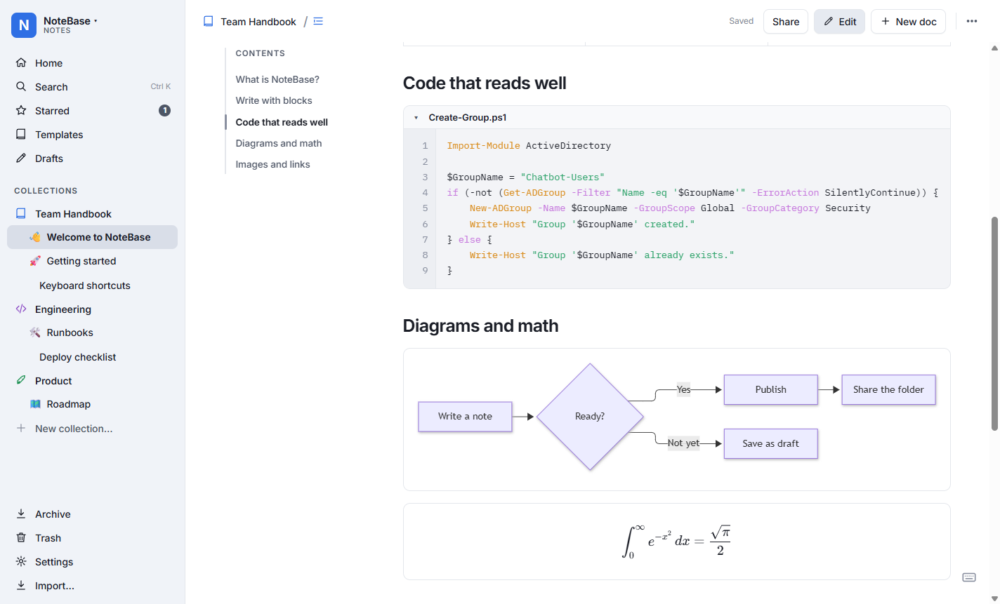
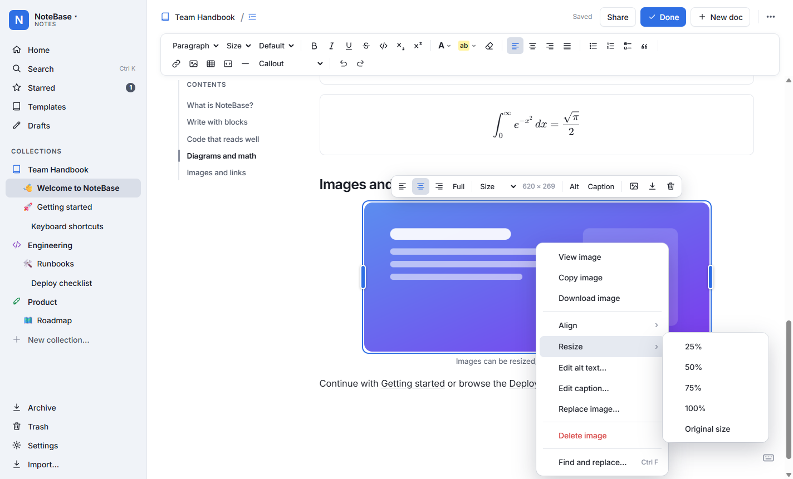
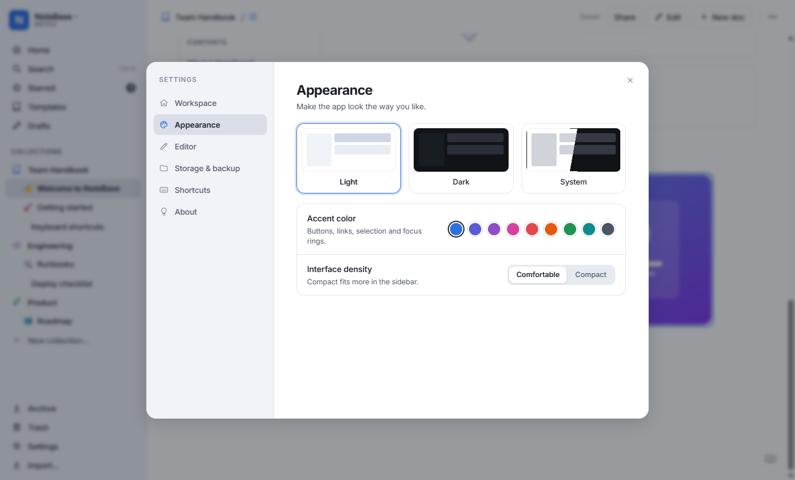
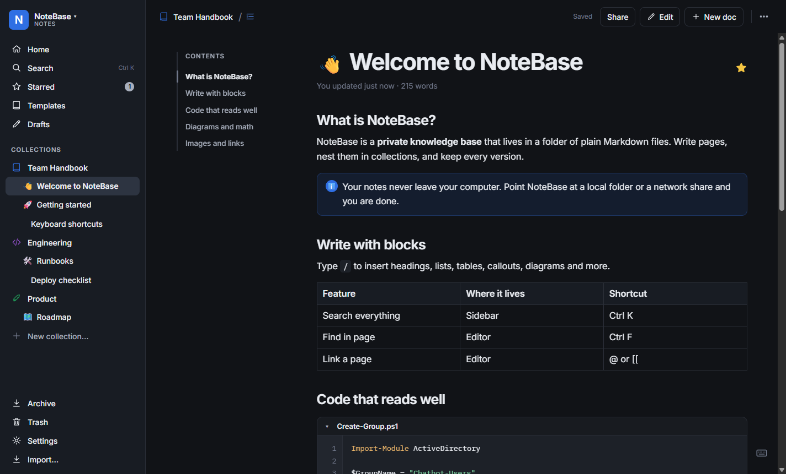

<h1 align="center">NoteBase</h1>

A private knowledge base that lives in a folder of plain Markdown files. 
Runs as a Windows desktop app or in Chrome / Edge. No account, no server, no cloud.

## Download

Get the Windows installer from the **[Releases page](https://github.com/Sagun78/NoteBase/releases/latest)**:

- `NoteBase-<version>-Setup.exe` — normal installer (per user, no admin needed)
- `NoteBase-<version>-Setup.msi` — the same app as an MSI, for managed deployment

The installers are not code-signed, so Windows SmartScreen may warn the first time: choose **More info**, then **Run anyway**. On first launch pick your notes folder; it is remembered after that.

## Based on Outline

NoteBase is modelled on **[Outline](https://github.com/outline/outline)**, the open-source team knowledge base ([getoutline.com](https://www.getoutline.com/) · [docs](https://docs.getoutline.com/)). It takes Outline's layout and ideas (collections, nested pages, a contents panel, a block editor with a slash menu, page links and backlinks) and turns them into a single-user, local-first app.

- Outline needs PostgreSQL, Redis and a sign-in provider. NoteBase needs none of those: your pages are `.md` files in a folder you choose.
- NoteBase is an **independent project written from scratch**. It does not contain Outline's source code, and it is **not affiliated with or endorsed by Outline or General Outline, Inc.**
- Outline itself is licensed under the [Business Source License 1.1](https://github.com/outline/outline/blob/main/LICENSE). If you want the full multi-user product (real-time collaboration, comments, sharing, permissions, integrations), use Outline.

## Screenshots

| | |
|---|---|
|    **Block editor** with a formatting toolbar and `/` menu |    **Code snippets**, diagrams and math |
|    **Right-click menus** and resizable images |    **Settings** for theme, accent colour and editor defaults |

 <b>Dark theme</b>

## Features

- **Your files, your folder.** Every page is a Markdown file; works on local folders and network shares. Version history, trash and a one-click `.zip` backup.
- **Organise.** Collections with nested pages (drag to reorder), starred pages, drafts, archive, templates, emoji icons, search (`Ctrl K`).
- **Write.** Slash menu, formatting toolbar, alignment, colours, callouts, tables, checklists, columns, find and replace, `@` page links with backlinks, emoji (`:name`).
- **Code snippets** with language picker, title, line numbers, wrap, collapse and copy. **Mermaid** diagrams and **LaTeX** formulas. **Embeds** for YouTube, Vimeo, Loom and Figma.
- **Images and files.** Paste, drop or insert; resize, align and caption; view full-screen.
- **Paste smartly.** Pasted Markdown becomes real formatting; pasted rich text keeps its colours, alignment and fonts.
- **Right-click menus** for text, links, images, tables and code, plus spelling suggestions in the desktop app.
- **Import and export.** Import Word (`.docx`), PDF, Markdown, HTML, MHTML, email (`.eml`), CSV/TSV, plain text, TextPack and scripts/code (`.py`, `.js`, `.ts`, `.ps1`, `.sh`, `.bat`, `.sql`, etc.), as several files at once or a whole folder (sub-folders become nested pages). Headings, lists, tables, links, bold/italic/underline and embedded images are kept; scripts are placed in syntax-highlighted code blocks with filename titles and line numbers; unreadable files are listed with the reason. Export as Markdown files or folders.

## Build the installers yourself

Releases are built automatically: pushing a tag such as `v1.0.1` runs `.github/workflows/release.yml`, which builds the installers on GitHub and attaches them to a Release. To build locally instead, run `npm run dist`. It writes two installers to `release/`:

- `NoteBase-1.0.0-Setup.exe` — normal installer (per user, no admin needed, Start Menu and desktop shortcuts)
- `NoteBase-1.0.0-Setup.msi` — the same app as an MSI, for managed deployment

Start **NoteBase** from the Start Menu or the desktop shortcut and choose your notes folder on first launch; it is remembered next time. The installers are not code-signed, so Windows SmartScreen may warn the first time ("More info", then "Run anyway").

## Other ways to run

- **Browser:** double-click `start.bat`, then open http://localhost:4173 in Chrome or Edge (uses the File System Access API).
- **Desktop, without installing:** `npm run desktop`
- **Development:** `npm run dev`

## Notes folder layout

`pages/<id>.md` (front matter + Markdown), `history/<id>/<timestamp>.md` (versions), `assets/` (images and files), `collections.json`.

## Scripts

| Command | What it does |
|---|---|
| `npm run build` | Build the web app into `dist/` |
| `npm run icons` | Regenerate all icons from `build/icon-source.webp` |
| `npm run dist` / `dist:exe` / `dist:msi` | Build the Windows installers |
| `node scripts/screenshots.cjs` | Regenerate the README screenshots from generated sample notes |
| `node scripts/smoke-desktop.cjs <notesDir> <userDataDir>` | Launch the desktop app against empty folders and check saving and reopening |

Adding `?opfs` to the browser URL uses a private in-browser folder, which is handy for trying the app without picking a folder.

## License

NoteBase is released under the [MIT License](LICENSE). Outline and the other projects listed below keep their own licences.

## Built with

- [Outline](https://github.com/outline/outline) — the project that inspired the design and feature set
- [TipTap](https://tiptap.dev/) and [ProseMirror](https://prosemirror.net/) — the editor
- [Electron](https://www.electronjs.org/) and [electron-builder](https://www.electron.build/) — the desktop app and installers
- [Vite](https://vite.dev/) — build tooling
- [Mermaid](https://mermaid.js.org/) and [KaTeX](https://katex.org/) — diagrams and math; [highlight.js](https://highlightjs.org/) — code colouring
- [fflate](https://github.com/101arrowz/fflate) — backups
- Fonts, bundled through [Fontsource](https://fontsource.org/): [Inter](https://rsms.me/inter/), [Source Serif 4](https://github.com/adobe-fonts/source-serif) and [iA Writer Mono](https://github.com/iaolo/iA-Fonts)
